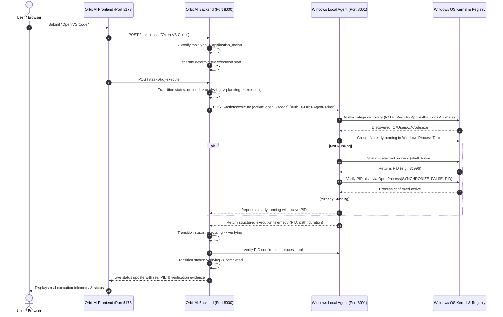

# Orbit AI — Windows Local Agent Guide

This document details the architecture, security model, startup instructions, and verification mechanisms for the **Orbit AI Windows Local Execution Agent**.

---

## 1. Executive Summary & Root Cause Analysis

### The Problem in Legacy Implementation
Previously, submitting tasks such as **"Open VS Code"** could report a completed task despite generating warnings that the application might not be available or without actually launching a verified process on the user's computer.

### Root Cause Analysis
1. **Fallback in Verification Logic**: In `tools/verification_tool.py`, the `_verify_process_running` handler had a fallback condition that inspected whether *any* process with the name `vscode` was running across the entire OS if the launch PID was missing or unverified. If the developer or user already had an editor open, the task spuriously verified as passed.
2. **Missing Process Table Coupling**: The legacy launcher invoked detached processes without capturing and propagating the operating system process ID (PID) directly to the verification engine.
3. **Absence of a Local Agent Service**: The hosted server attempted to inspect its own local environment rather than communicating with an authenticated, dedicated local Windows daemon running on the user's host machine.

### The Solution
We introduced the **Orbit AI Windows Local Agent**, a dedicated, high-performance local daemon running on `127.0.0.1:8001` that:
- Detects the actual Windows OS, release, architecture, and user context.
- Discovers installed executables via multiple strategies: standard Windows `PATH`, Registry `App Paths` (`HKCU` and `HKLM`), `LocalAppData`, and `ProgramFiles`.
- Launches processes safely using Windows APIs (`subprocess.Popen` with `DETACHED_PROCESS | CREATE_NEW_PROCESS_GROUP`, `shell=False`).
- Verifies process execution directly against the Windows kernel via `ctypes.windll.kernel32.OpenProcess`.
- Connects securely to the Orbit AI backend via loopback token pairing (`X-Orbit-Agent-Token`) and DNS rebinding protection.

---

## 2. Architecture & System Flow



---

## 3. Local Agent Components

| Component | File | Responsibility |
| :--- | :--- | :--- |
| **Configuration** | `local_agent/config.py` | Defines loopback port (8001), secure pairing token file, and authorized project directories. |
| **Security Layer** | `local_agent/security.py` | Restricts to loopback, enforces `X-Orbit-Agent-Token`, validates `Host` header against DNS rebinding, confines filesystem access to authorized directories, and writes audit logs. |
| **System Inspector** | `local_agent/system_inspector.py` | Inspects Windows architecture, release, user, and admin elevation. Discovers apps via PATH, Registry (`HKCU\Software\Microsoft\Windows\CurrentVersion\App Paths` and `HKLM`), and checks PIDs via Windows API. |
| **Process Launcher** | `local_agent/process_launcher.py` | Spawns detached processes with `shell=False`, captures real OS PIDs, and confirms process health immediately after launch. |
| **Tool Registry** | `local_agent/tool_registry.py` | Secure allowlist of local tools (`open_vscode`, `open_notepad`, `open_explorer`, `check_app_running`, `discover_app`, `inspect_directory`, `read_project_file`, `run_project_tests`). |
| **REST Server** | `local_agent/server.py` | FastAPI application exposing authenticated endpoints on `127.0.0.1:8001`. |

---

## 4. Security Architecture

1. **Loopback Binding**: The local agent binds exclusively to `127.0.0.1:8001`, preventing external network access.
2. **DNS Rebinding & Host Validation**: Enforces strict `Host` header checking (`localhost:8001`, `127.0.0.1:8001`). Cross-origin requests from malicious websites cannot target the local agent.
3. **Restricted Token Authentication**: All mutating endpoints require `X-Orbit-Agent-Token` header. The token is generated locally in `.orbit_agent_token` with user-only permissions.
4. **No Arbitrary Shell Execution**: Tools launch specific binaries without shell invocation (`shell=False`), preventing command injection.
5. **Path Confinement**: Directory inspection and file reading tools only allow paths within explicitly authorized directories (the workspace root). Traversals outside the root are blocked.
6. **Audit Trail**: Every request and local execution is logged with timestamp, client IP, action name, and parameters to `local_agent_audit.log`.

---

## 5. Startup & Operating Instructions

### Prerequisites
- Windows 10 or 11 (AMD64 / ARM64)
- Python 3.10+ (configured in `.venv`)

### Starting the Services

#### Option A: Quickstart via Batch Script
Double-click `start_local_agent.bat` in the project root:
```cmd
start_local_agent.bat
```

#### Option B: Manual PowerShell / CMD
In your terminal, activate your virtual environment and run:
```powershell
.\.venv\Scripts\Activate.ps1
python start_local_agent.py
```
Output:
```
INFO:     Started server process [9532]
INFO:     Waiting for application startup.
INFO:     Application startup complete.
INFO:     Uvicorn running on http://127.0.0.1:8001 (Press CTRL+C to quit)
```

### Starting the Full Stack
1. **Windows Local Agent**:
   ```powershell
   python start_local_agent.py
   ```
2. **Orbit AI Backend**:
   ```powershell
   python -m uvicorn api.main:app --host 127.0.0.1 --port 8000
   ```
3. **Frontend Dashboard**:
   ```powershell
   cd frontend
   npm run dev
   ```
   Open `http://localhost:5173` in your browser.

---

## 6. Truthful Task Lifecycle & Dashboard Metrics

### Lifecycle Progression
Orbit AI implements genuine, verifiable state transitions:
```
queued ──> analyzing ──> planning ──> executing ──> verifying ──> completed
                                             │               │
                                             └───> failed <──┘
                                             │
                                             └───> blocked (e.g. Agent Offline)
```

- **A plan is not an execution result**: Generating steps leaves the task in `planned`, never `completed`.
- **An application launch is not a code test**:
  - **Application Action Tasks**: Verified by querying the Windows kernel for an active OS PID.
  - **SDLC Code Tasks**: Verified by executing automated tests (`pytest`) in isolated workspace directories.
- **Truthful Dashboard Counters**:
  - `Tasks Total`: Total count of persistent task records.
  - `Code Tests Verified`: Count of tasks where test suites passed.
  - `App Launches Verified`: Count of tasks where an operating system process was launched and verified active.
  - `Blocked / Failed`: Count of tasks halted due to offline agents or execution errors.

---

## 7. Automated Testing Suite

The implementation includes tests covering all 12 specified scenarios plus a live Windows integration test:

| Test Name | Scenario Tested | Status |
| :--- | :--- | :--- |
| `test_scenario_1_vscode_installed_and_not_running` | Discovers VS Code, launches it safely, and verifies the PID. | **PASSED** |
| `test_scenario_2_vscode_already_running` | Detects running instance, reports active PIDs, and avoids duplicate launches. | **PASSED** |
| `test_scenario_3_vscode_installed_outside_path` | Discovers executable via Windows Registry `App Paths` or `LocalAppData`. | **PASSED** |
| `test_scenario_4_vscode_not_installed` | Fails gracefully with actionable installation instructions and download link. | **PASSED** |
| `test_scenario_5_local_agent_offline` | Transitions task to `blocked` when agent is unreachable, showing startup guidance. | **PASSED** |
| `test_scenario_6_process_launch_failure` | Detects process launch failure and records diagnostic error without marking completed. | **PASSED** |
| `test_scenario_7_process_verification_failure` | Catches zombie/exited processes post-launch and marks task `failed`. | **PASSED** |
| `test_scenario_8_unauthorized_api_request` | Validates rejection of requests missing or having invalid `X-Orbit-Agent-Token`. | **PASSED** |
| `test_scenario_9_invalid_application_name_or_path` | Prevents path injection, illegal characters, and unauthorized executable paths. | **PASSED** |
| `test_scenario_10_task_retry_and_duplicate_submission` | Prevents duplicate concurrent executions and safely updates task history on retry. | **PASSED** |
| `test_scenario_11_false_success_prevention` | Asserts that failure to launch or verify never marks task status as `completed`. | **PASSED** |
| `test_scenario_12_lifecycle_updates_and_database_persistence` | Verifies full state transition history and step execution audit records in SQLite. | **PASSED** |
| `test_real_windows_integration_launch_vscode` | Real live integration test on Windows host: launches VS Code and confirms PID via `kernel32.OpenProcess`. | **PASSED** |

### Running the Tests
To execute the Windows local agent test suite:
```powershell
python -m pytest tests/test_windows_local_agent.py -v
```
To run all 170+ backend tests:
```powershell
python -m pytest
```
To run all 50 frontend Vitest tests:
```powershell
cd frontend
npm test
```
