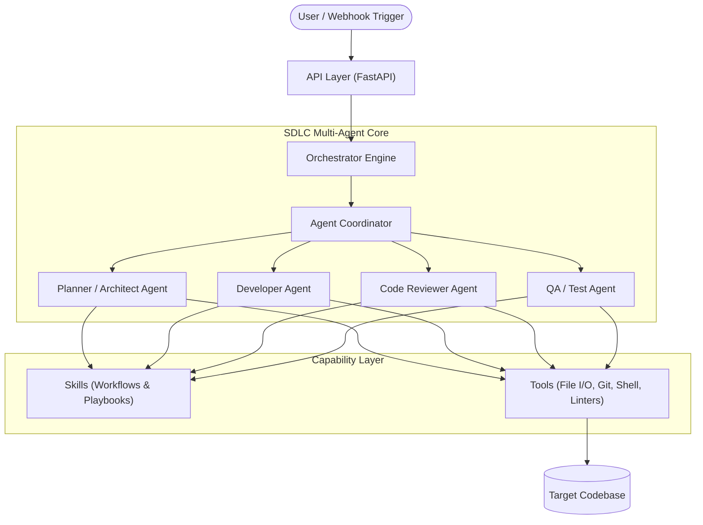

# Autonomous SDLC Engine Architecture

## Overview

The **Autonomous SDLC Engine** is an intelligent, multi-agent platform designed to automate and augment end-to-end software engineering workflows—from requirement analysis and architectural design to implementation, review, testing, and delivery.

---

## Architectural Principles

1. **Modularity & Separation of Concerns**: Each component (orchestrator, agents, tools, skills) has a focused responsibility with well-defined interfaces.
2. **Deterministic Tooling, Autonomous Planning**: Agents reason over high-level plans and make tactical decisions, but interact with code repositories exclusively via deterministic, sandboxed tools.
3. **Inspectable State & Auditability**: Every workflow step, artifact transformation, and tool execution is logged and verifiable.
4. **Iterative Verification Loop**: Code generated by agents is continuously tested, analyzed, and reviewed by specialized peer agents before delivery.

---

## High-Level System Architecture

---

## Component Breakdown

### 1. `api/`
- **Purpose**: External interface providing REST and WebSocket endpoints.
- **Responsibilities**:
  - Health checks and service monitoring.
  - Job submission, status polling, and human-in-the-loop interactions.
  - Webhook integration for CI/CD and repository events.

### 2. `orchestrator/`
- **Purpose**: Execution engine coordinating workflow lifecycles.
- **Responsibilities**:
  - Manages the state machine / execution DAG.
  - Handles task assignment, sequencing, and artifact flow between agents.
  - Enforces safety boundaries, timeouts, and checkpointing.

### 3. `agents/`
- **Purpose**: Autonomous agents specialized in distinct phases of software engineering.
- **Planned Roles**:
  - **Architect / Planner Agent**: Deconstructs requirements into concrete tasks and dependency graphs.
  - **Developer Agent**: Writes and modifies code according to task specifications.
  - **Reviewer Agent**: Evaluates diffs for security, logic errors, and style guidelines.
  - **QA Agent**: Formulates test cases and interprets execution outputs to drive bug fixes.

### 4. `tools/`
- **Purpose**: Reusable execution primitives.
- **Responsibilities**:
  - Filesystem inspection and editing (e.g., AST-aware patchers).
  - Terminal and process execution within sandboxes.
  - Git operations (branching, commits, diffs).
  - Static code analysis, type checkers, and test runners.

### 5. `skills/`
- **Purpose**: High-level procedural knowledge packs.
- **Responsibilities**:
  - Reusable problem-solving patterns (e.g., refactoring patterns, framework migrations, test-driven development workflows).
  - Prompt templates, evaluation metrics, and domain-specific rules.

### 6. `tests/`
- **Purpose**: Automated test suite.
- **Responsibilities**:
  - Unit tests for tools, orchestrator logic, and API endpoints.
  - Integration tests for agent workflows.
  - Evaluation benchmarks for agent performance and regression prevention.

---

## Roadmap

- [x] Phase 1: Foundation & Project Scaffolding
- [ ] Phase 2: Orchestration State Machine & Context Bus
- [ ] Phase 3: Tool Execution Sandbox (Filesystem & Terminal)
- [ ] Phase 4: Core Agent Definitions & Prompt Pipelines
- [ ] Phase 5: Feedback & Auto-Correction Loop (Test Execution + LLM Debugger)
- [ ] Phase 6: Human-in-the-Loop Review & Git Integration
